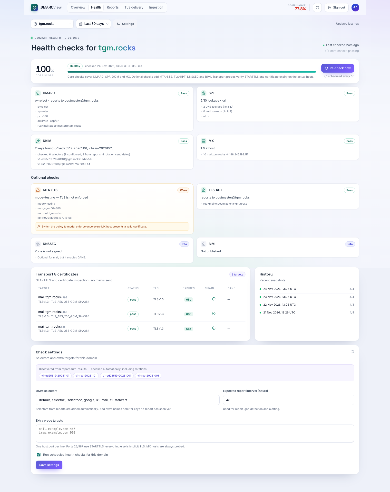
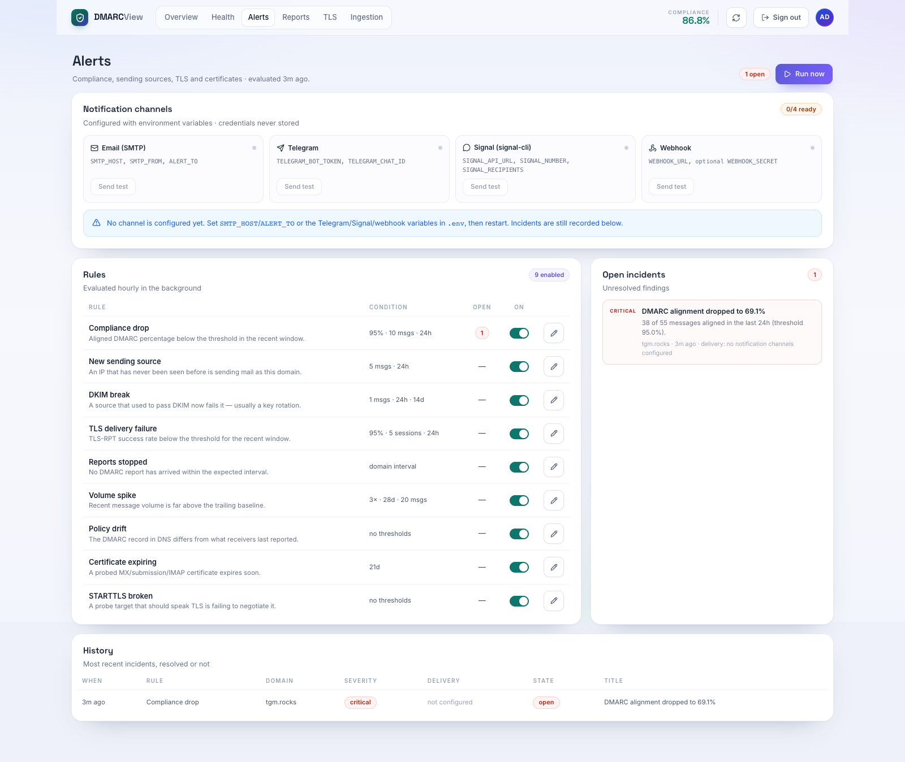
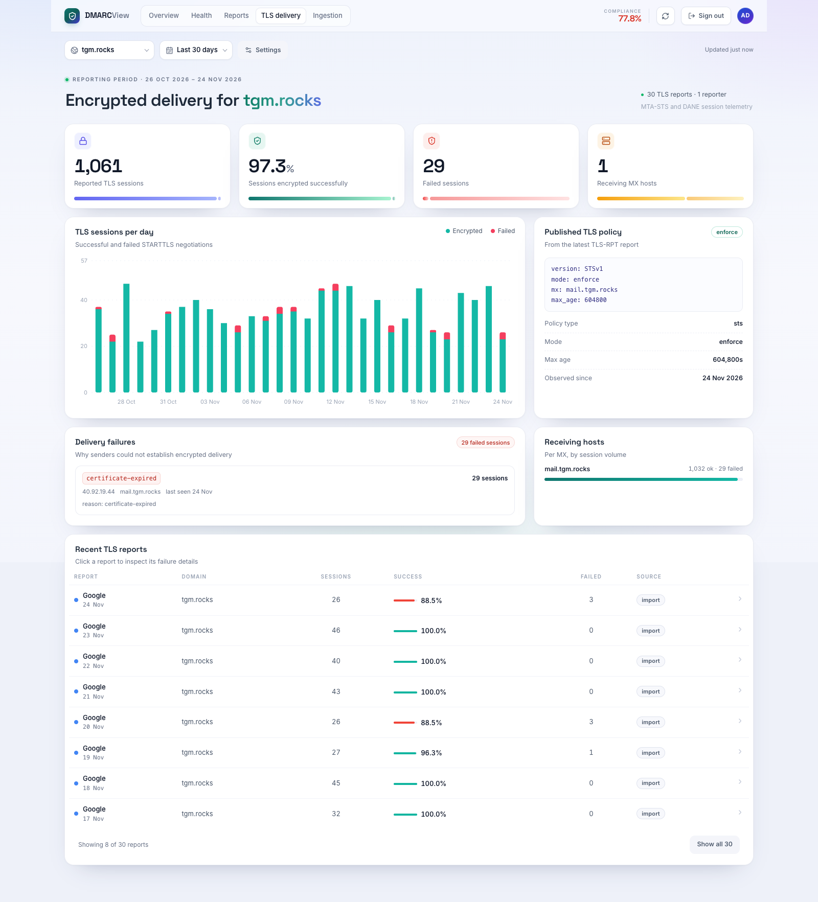
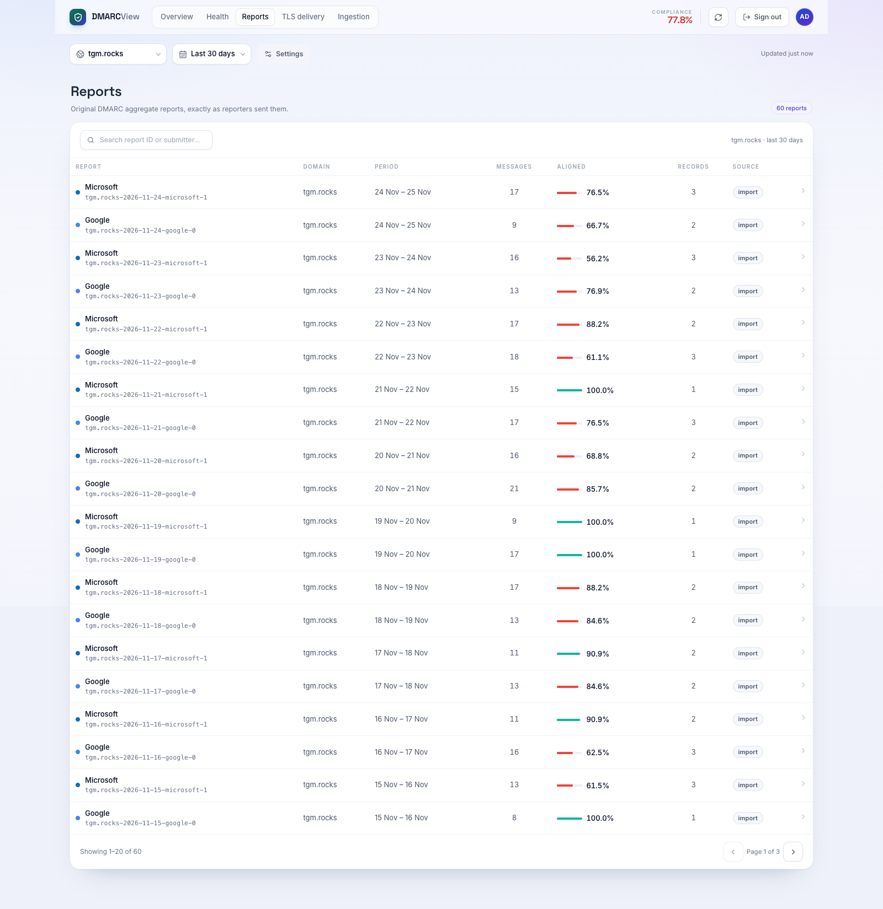

# DMARCView

Self-hosted DMARC and TLS-RPT reporting for Stalwart (or any JMAP server), with a
dashboard modelled on the polished SaaS tools — but running entirely on your own box.


Report emails are fetched over JMAP, parsed offline, stored in SQLite and turned into
answers: *is my mail authenticating, who is sending as me, and is delivery encrypted?*

---

## What it does

- **Pulls reports automatically.** Polls a dedicated mailbox over JMAP with an
  incremental cursor — new mail is picked up every few minutes, and the first sync can
  look back 90 days.
- **Parses the real world.** DMARC aggregate XML from zip, gzip, `application/octet-stream`
  or inline bodies, with dmarc-1.0/2.0 or no namespace; TLS-RPT JSON with both RFC and
  draft key spellings. Every report is kept byte-for-byte for audit and re-parsing.
- **Answers the questions you actually have.**
  - Compliance over time, aligned vs. failing volume per day.
  - Sending sources grouped into *verified* / *not verified*, with the raw SPF and DKIM
    result *and* the aligned DMARC verdict shown separately.
  - Sender **identities**: rotating ESP addresses collapse into one row per envelope/DKIM
    identity, with messages, alignment, sources and network context.
  - Period-over-period deltas ("what changed"), new identities, and a volume anomaly score
    against the trailing baseline.
  - Coverage: silent reporters, other header-from domains against the effective DMARCbis
    policy, and the legacy `pct` timeline.
  - Top countries, mailbox providers, plain-English summary, and a policy recommendation.
- **Simulate before tightening.** Project a proposed `p=`/`sp=`/`np=`/`t=` policy over stored
  reports: which sources would be newly quarantined or rejected, what stays the same, and a
  confidence-labelled risk verdict — read-only, with no DNS writes.
- **Domain timeline.** One chronology of alerts, DNS changes, new identities, report gaps and
  private operator notes, so a change can be explained after the fact. DNS/SPF/MTA-STS/TLS-RPT
  snapshot changes are shown with before/after summaries.
- **Saved fleet views.** Name and recall fleet filters and sort order: group, policy, health,
  failing sources, alignment/TLS thresholds.
- **Operator diagnostics.** Per-domain alert thresholds, a DNS/SPF/MTA-STS/TLS-RPT diff history,
  reporter quality scores, delivery attempts with manual retry, digest controls, an append-only
  audit log, and sending-IP PTR/forward-confirmed rDNS context.
- **TLS delivery.** Session success rate per MX host, every policy domain in multi-policy
  TLS-RPT reports, failure reasons
  (`certificate-expired`, `starttls-not-supported`, …) and the reporters behind them.
- **Checks your configuration, not just your reports.** Live DNS checks for DMARC, SPF (with the
  10-lookup limit), DKIM selectors, MX with PTR confirmation, MTA-STS (policy-id and MX
  consistency), TLS-RPT, DNSSEC, BIMI, CAA and optional HELO/EHLO DNS.
  DMARC policy discovery follows RFC 9989: if a domain has no record, parent/PSD records are
  found by tree walk, with `sp=`, `np=`, `t=` and `psd=` applied, external `rua=`/`ruf=`
  destinations verified, and a readiness panel for the current record. Because outbound port
  25 is allowed, it also probes MX, submission and IMAP endpoints: STARTTLS, TLS version,
  certificate chain, hostname, expiry and DANE/TLSA.
- **Keeps the routine quiet.** Mark known ESP networks, ASNs or sending domains so first-seen
  alerts stay meaningful, then silence or retune a rule for one domain without changing the
  global policy. A weekly email digest — SMTP or JMAP — covers domains you do not open every day.
- **Tells you when it changes.** Thirteen alert rules cover compliance drops, new senders, DKIM
  breaks, TLS failures, silent report gaps, volume spikes, policy drift, certificate expiry,
  health-check regressions and failing JMAP syncs, delivered over SMTP or JMAP email submission,
  Telegram, Signal (signal-cli) or a signed webhook.
- **Runs itself.** An in-process scheduler re-checks every few hours, evaluates alerts,
  reverse-resolves sending IPs, and reports every run in the UI. No cron, Redis or Celery.
- **Multi-domain.** A fleet view plus a per-domain drill-down with a domain picker; free-form
  domain tags/group filters for larger fleets.
- **Share safely.** Signed, expiring, revocable read-only links for one domain or the whole
  fleet — no account required. Raw reports, search, alert settings and the admin area stay
  private.
- **Export or compare.** Download the current view as CSV/JSON, a capped raw-report ZIP, or
  compare every domain side by side (volume, alignment, TLS, policy, health, 14-day trend).
- **Report browser.** Search, filter, inspect every record, download the original XML/JSON;
  RFC 9990 reporter warnings are shown separately from DMARC failures.
- **Boring to operate.** One container, one SQLite file, consistent local backups plus optional
  WebDAV/S3 off-box bundles, a tested restore path, no telemetry and no third-party IP lookups
  (GeoIP is local).

| Domain health | Alerts |
| --- | --- |
|  |  |

| TLS delivery | Report browser |
| --- | --- |
|  |  |

| Shared read-only view |
| --- |
|  |

---

## Quick start (Docker)

```bash
git clone <this-repo> dmarcview && cd dmarcview
cp .env.example .env
$EDITOR .env                      # set SECRET_KEY, ADMIN_PASSWORD, JMAP_*
python3 scripts/fetch_geoip.py geoip   # optional: country flags
docker compose up -d --build
```

Open <http://localhost:8000> and sign in with `ADMIN_USERNAME` / `ADMIN_PASSWORD`.

> **Cookie gotcha:** `.env.example` ships `COOKIE_SECURE=false` so plain-HTTP localhost
> works. If you put DMARCView behind HTTPS (you should), set it to `true` — otherwise
> the session cookie is dropped and you will bounce back to the login screen.

Check that ingestion works:

```bash
docker compose exec dmarcview python -m app.cli probe
docker compose exec dmarcview python -m app.cli sync
docker compose logs -f
```

Health checks start about 25 seconds after boot and then run every six hours; the first
report, the DNS snapshot and the transport probes appear on the Overview and Health pages
automatically. To force a run, use **Re-check now** on a domain, or the CLI
(`python -m app.cli` — see below) inside the container.

Write a local backup (consistent snapshot, safe while running):

```bash
docker compose exec dmarcview python -m app.cli backup --keep 14
```

Data lives in the `dmarcview-data` Docker volume:

```bash
docker run --rm -v dmarcview_dmarcview-data:/data -v "$PWD":/backup alpine \
  tar czf /backup/dmarcview-backup.tgz -C /data .
```

The running version is shown in the footer. Release images receive it from the tag through the
`APP_VERSION` Docker build argument; source builds use the fallback in `backend/app/version.py`.

## Release notes

Tagged releases get structured notes automatically. The workflow first asks GitHub for its
generated changelog, then, when `DEEPSEEK_API_KEY` is configured, asks a DeepSeek chat model to
turn the commit/diff evidence into prose, highlights, upgrade notes and verification notes. The
model output is normalized to one line per paragraph/bullet. If the token is missing or the API
fails, the GitHub-generated notes are used instead.

Configure the token as a **repository Actions secret** — never in `.env`, the repository or a
workflow file:

```bash
gh secret set DEEPSEEK_API_KEY --repo ComSubVie/DMARCview
# paste the token at the prompt
```

Or use **Settings → Secrets and variables → Actions → New repository secret**. Optional
repository variables:

- `DEEPSEEK_MODEL` — defaults to `deepseek-chat`.
- `DEEPSEEK_API_URL` — defaults to `https://api.deepseek.com/chat/completions`.

The release is created only after the image publish succeeds, and an existing release is never
rewritten. The generated body is followed by the Full Changelog link, container image and digest.

## Published container images

`.github/workflows/publish-image.yml` builds a multi-architecture image (`linux/amd64`,
`linux/arm64`) and publishes it to the GitHub Container Registry as
`ghcr.io/<your-github-user>/dmarcview`.

| Tag | Source |
| --- | --- |
| `edge` | every push to the default branch |
| `1.2.3`, `1.2`, `1` | a `v1.2.3` tag |
| `latest` | the newest stable release tag |
| `sha-abc1234` | every build |

```bash
docker pull ghcr.io/<your-github-user>/dmarcview:latest
```

To run the published image instead of building locally:

```bash
export DMARCVIEW_IMAGE=ghcr.io/<your-github-user>/dmarcview:latest
docker compose pull
docker compose up -d --no-build
```

Every run first executes the backend test suite and a production frontend build; the image
is only published if those pass. Pull requests build `linux/amd64` only and never push.
Releases are published with SBOM and provenance attestations. GHCR packages start private — make the package public under
*GitHub → your profile → Packages* if you want unauthenticated pulls.

Publish a release with:

```bash
git tag v1.2.0 && git push origin v1.2.0
```

The tag workflow builds and tests first, then publishes the image and creates the GitHub
Release automatically with generated notes plus the image reference and digest. Re-running
the workflow leaves an existing release (and any hand-edited notes) untouched.

## Without Docker

```bash
python3 -m venv .venv && . .venv/bin/activate
pip install -r backend/requirements.txt

cd frontend && npm ci && npm run build && cd ..

export SECRET_KEY="$(openssl rand -base64 36)"
export ADMIN_PASSWORD="a-long-password"
export JMAP_ENABLED=true JMAP_URL=https://mail.example.com \
       JMAP_USERNAME=dmarc@example.com JMAP_PASSWORD=... JMAP_MAILBOX=DMARC

cd backend
uvicorn app.main:app --host 127.0.0.1 --port 8000
```

The built SPA is served by FastAPI from `frontend/dist`. For UI work run
`npm run dev` in `frontend/` — Vite proxies `/api` to `127.0.0.1:8000`.

---

## Stalwart setup

1. **Create a mailbox** for reports, e.g. `dmarc@yourdomain.tld`, and a folder named
   `DMARC` (or point `JMAP_MAILBOX` at any existing folder).
2. **Publish the reporting addresses** in DNS:

   ```dns
   _dmarc.yourdomain.tld.        TXT "v=DMARC1; p=reject; rua=mailto:dmarc@yourdomain.tld"
   _smtp._tls.yourdomain.tld.    TXT "v=TLSRPTv1; rua=mailto:tlsrpt@yourdomain.tld"
   ```

   Receivers send aggregate reports once a day; most start arriving within 48 hours.
3. **Give DMARCView credentials** that can read that mailbox. Stalwart accepts basic
   auth with an account password, or a bearer token:

   ```env
   JMAP_ENABLED=true
   JMAP_URL=https://mail.yourdomain.tld
   JMAP_USERNAME=dmarc@yourdomain.tld
   JMAP_PASSWORD=…
   JMAP_MAILBOX=DMARC
   ```

4. **Verify** with `python -m app.cli probe`. It prints the account, every mailbox it can
   see, and whether `JMAP_MAILBOX` resolved. A failed lookup lists the available folders.

Reports can also arrive by forwarding to another mailbox; any JMAP account that can read
them works. IMAP is not implemented (the transport is a single interface, so adding one
is straightforward).

---

## Configuration

All settings are environment variables (`.env` is loaded automatically).

| Variable | Default | Purpose |
| --- | --- | --- |
| `SECRET_KEY` | dev value | Signs the session cookie. **Set it.** |
| `ADMIN_USERNAME` | `admin` | Login name. |
| `ADMIN_PASSWORD` | — | Plain password (dev/simple). |
| `ADMIN_PASSWORD_HASH` | — | PBKDF2 hash; preferred over the plain password. |
| `COOKIE_SECURE` | `false` | `true` when served over HTTPS. |
| `SESSION_MAX_AGE` | `1209600` | Session lifetime in seconds. |
| `JMAP_ENABLED` | `false` | Turn scheduled polling on. |
| `JMAP_URL` | — | Server base URL, e.g. `https://mail.example.com`. |
| `JMAP_USERNAME` / `JMAP_PASSWORD` | — | Basic-auth credentials. |
| `JMAP_TOKEN` | — | Bearer token instead of basic auth. |
| `JMAP_MAILBOX` | `DMARC` | Folder name to poll. |
| `JMAP_FROM` | `SMTP_FROM` | Sender identity/address for JMAP email submission. |
| `JMAP_POLL_SECONDS` | `300` | Poll interval (min 30). |
| `INGEST_INITIAL_DAYS` | `90` | How far back the first sync looks. |
| `DNS_NAMESERVERS` | system | Comma-separated resolvers for health checks. Use a validating resolver for DNSSEC. |
| `HEALTH_CHECKS_ENABLED` | `true` | Run the scheduled DNS/transport jobs at all. |
| `HEALTH_INTERVAL_MINUTES` | `360` | How often domain health checks run. |
| `PROBE_INTERVAL_MINUTES` | `360` | How often MX/submission/IMAP probes run. |
| `PROBE_TIMEOUT_SECONDS` | `8` | Per-target connect/handshake timeout. |
| `HTTP_TIMEOUT_SECONDS` | `6` | Timeout for MTA-STS and BIMI fetches. |
| `PTR_ENRICHMENT_ENABLED` | `true` | Reverse-resolve sending IPs and forward-confirm their PTR names. |
| `HELO_HOSTNAME` | — | Expected outbound EHLO/HELO FQDN for the DNS readiness check; does not configure Stalwart. A domain setting can override it. |
| `JOBS_INITIAL_DELAY_SECONDS` | `25` | Delay before the first scheduled run after boot. |
| `BACKUP_KEEP` | `14` | Local snapshots retained by `app.cli backup`. |
| `BACKUP_ENABLED` | `false` | Schedule local backups and off-box uploads. |
| `BACKUP_INTERVAL_HOURS` | `24` | Backup job cadence. |
| `BACKUP_WEBDAV_URL` | — | Existing WebDAV folder for off-box bundles. |
| `BACKUP_WEBDAV_USERNAME` / `BACKUP_WEBDAV_PASSWORD` | — | WebDAV basic-auth credentials. |
| `BACKUP_S3_BUCKET` / `BACKUP_S3_REGION` | — / `us-east-1` | S3-compatible backup bucket. |
| `BACKUP_S3_ENDPOINT` | AWS | S3-compatible endpoint (MinIO, B2, Wasabi). |
| `BACKUP_S3_ACCESS_KEY` / `BACKUP_S3_SECRET_KEY` | — | S3 credentials; omit to use the instance role/default chain. |
| `BACKUP_S3_PREFIX` | `dmarcview/` | Object-key prefix. |
| `RETENTION_DAYS` | `0` | Archive raw payloads and prune reports older than this. `0` keeps forever. |
| `ALERTS_ENABLED` | `true` | Run the alert evaluator on a schedule. |
| `ALERT_INTERVAL_MINUTES` | `60` | Alert evaluation cadence. |
| `ALERT_COOLDOWN_MINUTES` | `60` | Minimum gap between repeated episodes of one finding. |
| `ALERT_BASE_URL` | — | Public URL used for links in notifications. |
| `EMAIL_TRANSPORT` | `auto` | `auto` uses SMTP when configured, otherwise JMAP; `smtp`/`jmap` force one transport. |
| `SMTP_HOST` / `SMTP_PORT` | — / `587` | SMTP relay for email alerts. |
| `SMTP_SECURITY` | `starttls` | `starttls`, `ssl` or `none`. |
| `SMTP_USERNAME` / `SMTP_PASSWORD` | — | Optional SMTP authentication. |
| `SMTP_FROM` | — | Sender address for alerts. |
| `ALERT_TO` | — | Comma-separated recipients. |
| `DIGEST_ENABLED` | `false` | Send a weekly fleet email digest over the selected email transport. |
| `DIGEST_TO` | `ALERT_TO` | Digest recipients when they differ from alert recipients. |
| `DIGEST_DAYS` | `7` | Digest window and minimum interval between sends. |
| `TELEGRAM_BOT_TOKEN` / `TELEGRAM_CHAT_ID` | — | Telegram delivery. |
| `SIGNAL_API_URL` / `SIGNAL_NUMBER` / `SIGNAL_RECIPIENTS` | — | Signal via a signal-cli REST sidecar. |
| `WEBHOOK_URL` / `WEBHOOK_SECRET` | — | JSON webhook with an HMAC signature. |
| `MONTHLY_MESSAGE_ALERT` | `10000` | Progress-bar target on the dashboard. |
| `GEOIP_DB` | auto | Path to the country `.mmdb`; otherwise `data/geoip/*country*.mmdb`. |
| `GEOIP_ASN_DB` | auto | Path to the ASN `.mmdb`; otherwise `data/geoip/*asn*.mmdb`. |
| `DATA_DIR` | `./data` | Database location outside Docker. |
| `DATABASE_URL` | `sqlite:///…/data/dmarc.db` | Full SQLAlchemy URL. |
| `FRONTEND_DIST` | `frontend/dist` | Built SPA location. |
| `ROOT_PATH` | — | Set when serving under a sub-path. |
| `DMARCVIEW_VERSION` | source constant | Set automatically from the git tag by the release workflow; shown in the UI footer. |

Generate a password hash instead of storing a plaintext password:

```bash
python -m app.cli hash-password
# -> pbkdf2_sha256$310000$…
```

---

## GeoIP (optional)

Country flags and the *Top countries* card come from a local MaxMind-format database.
Nothing is sent to a third party.

```bash
python3 scripts/fetch_geoip.py geoip     # DB-IP Lite, refreshed monthly
```

The script fetches both the country and ASN databases (use `--no-asn` to skip the latter).
The ASN database is what lets sender identities show a network/organisation; without it the
grouping still works using envelope/DKIM domains and PTR. The script tries the current month
and falls back two months, and picks a working TLS trust store automatically (certifi, then
the usual system bundles), because some python.org builds ship a stale one. If a proxy intercepts TLS, pass `--ca-file /path/to/bundle.pem` (or
`--insecure` as a last resort). Restart the container after adding the file so the resolver
picks it up. Without a database the app runs normally; countries render as *Unknown*.

Country is resolved **when a report is ingested**. Rows imported before the database was
present keep their empty country until you backfill them:

```bash
docker compose exec dmarcview python -m app.cli geo-enrich
# or, outside Docker:
python -m app.cli geo-enrich
```

`--all` re-resolves every IP instead of only rows with no country. Reload the dashboard
afterwards; the command reports IPs, resolved IPs and updated rows.

> IP Geolocation by [DB-IP](https://db-ip.com) (CC BY 4.0). MaxMind GeoLite2 also works —
> point `GEOIP_DB` / `GEOIP_ASN_DB` at the `.mmdb` files.

---

## CLI

```bash
python -m app.cli hash-password       # print a PBKDF2 hash
python -m app.cli init-db             # create/migrate the schema
python -m app.cli probe               # JMAP session + mailbox discovery
python -m app.cli sync                # one JMAP sync (incremental, cron-friendly)
python -m app.cli sync --days 90      # backfill from a date, ignoring the cursor
python -m app.cli sync --all          # rescan the whole mailbox (up to --max)
python -m app.cli mailbox-debug --days 90 --json  # read-only message/payload report
python -m app.cli import samples/*.eml  # offline import of .eml / .zip
python -m app.cli migrate             # apply database migrations
python -m app.cli backup --keep 14    # consistent SQLite snapshot
python -m app.cli restore path.db --yes  # restore after stopping the app
python -m app.cli geo-enrich          # backfill countries for existing rows
python -m app.cli prune --dry-run     # preview retention (archive + delete)
python -m app.cli prune --days 365 --yes  # archive and delete reports older than a year
python -m app.cli stats               # row counts
```

`import` is handy for backfilling an archive of saved report emails, or for checking a
parser fix before pointing the poller at the mailbox.

---

## How ingestion stays idempotent

Three layers prevent double counting:

1. **Mailbox message** — `ProcessedMessage.source_key` (`jmap:<email-id>` or
   `upload:<sha256>`) means a message is only parsed once.
2. **Attachment digest** — `raw_sha256` on each report. The same XML delivered twice (or
   as a different message) is ignored.
3. **Reporter report id** — `(org_name, report_id)` is unique, so re-sent reports cannot
   duplicate.

The poller keeps a cursor in `sync_state` (`jmap.last_received_at`) and overlaps by one
day for safety; the layers above absorb the overlap.

Malformed reports never abort a batch: the error is recorded on the message/run and the
next attachment is still processed.

---

## API

Everything below requires the session cookie (obtained via `POST /api/auth/login`).

| Method | Path | Description |
| --- | --- | --- |
| `GET` | `/api/dashboard?domain=&days=` | KPIs, daily series, sources, countries, policy, advice |
| `GET` | `/api/domains` | Domain list with 30-day stats |
| `GET` | `/api/reports` | Paged/filtered DMARC reports (`q`, `days`, `page`) |
| `GET` | `/api/reports/{id}` | Report detail with every record |
| `GET` | `/api/reports/{id}/raw` | Original XML download |
| `GET` | `/api/tls` | TLS-RPT KPIs, per-day sessions, failures, policies |
| `GET` | `/api/tls/reports/{id}` | TLS report detail |
| `POST` | `/api/ingest/run` | Trigger a sync (202, runs in background) |
| `POST` | `/api/ingest/upload` | Upload `.eml`/`.zip` files (multipart `files`) |
| `POST` | `/api/ingest/probe` | JMAP connectivity check |
| `GET` | `/api/ingest/status` | Poller state, counts, recent runs |
| `GET` | `/api/domain-health?domain=` | Latest DNS checks, probes and settings |
| `POST` | `/api/domain-health/run?domain=` | Run DNS checks and probes now |
| `GET` | `/api/domain-health/fleet` | Health summary per domain |
| `GET` | `/api/domain-health/history?domain=` | Snapshot history |
| `GET/PUT` | `/api/domains/{name}/settings` | DKIM selectors, probe targets, cadence |
| `GET` | `/api/alerts` | Rules, channels, incidents and last evaluation |
| `PUT` | `/api/alerts/rules/{id}` | Enable/disable, thresholds and cooldown |
| `POST` | `/api/alerts/run` | Evaluate all rules now |
| `POST` | `/api/alerts/test` | Send a test notification |
| `GET` | `/api/share-links` | List active/revoked share links |
| `POST` | `/api/share-links` | Create a signed read-only link |
| `POST` | `/api/share-links/{id}/revoke` | Revoke a link immediately |
| `GET` | `/api/public/{token}` | Unauthenticated read-only dashboard payload |
| `GET` | `/api/export/reports.csv` / `.json` | DMARC reports with current filters |
| `GET` | `/api/export/sources.csv` | Aggregated sending sources |
| `GET` | `/api/export/tls.csv` | TLS-RPT reports |
| `GET` | `/api/export/raw.zip` | Capped archive of original XML/JSON |
| `GET` | `/api/storage` | Database, archive and backup sizes |
| `GET` | `/api/jobs` | Scheduled jobs and their last run |
| `GET` | `/api/health` | Unauthenticated liveness probe |

---

## Architecture

```
          ┌────────────┐   JMAP    ┌──────────────────────────────┐
 Stalwart │  DMARC box │◀──────────│ poller (asyncio, cursor)      │
          └────────────┘           │   ↓                          │
                                   │ MIME unwrap (zip/gz/inline)  │
                                   │   ↓            ↓             │
                                   │ DMARC XML   TLS-RPT JSON     │
                                   │   ↓            ↓             │
                                   │ SQLite (sqlmodel) + raw blobs│
                                   └──────────────┬───────────────┘
                                                  │ FastAPI
                                   ┌──────────────▼───────────────┐
                                   │ React + Vite + Recharts SPA  │
                                   └──────────────────────────────┘
```

- **Backend** `backend/app`: FastAPI, SQLModel/SQLite (WAL), Alembic migrations, httpx JMAP
  client, DNS checks on dnspython, certificate parsing with `cryptography`. Report parsers use
  only stdlib `email`/`xml`/`zipfile`/`gzip`. Alert rules live in `app/alerts`, evaluate from
  the scheduler and deliver through SMTP/Telegram/Signal/webhook without extra services.
- **Frontend** `frontend/src`: React 19, React Router, Recharts, hand-written CSS design
  system (no UI framework), self-hosted Inter + Space Grotesk.
- **Storage**: one SQLite file plus raw XML/JSON blobs. A few thousand reports per domain
  per year is comfortably within SQLite's range.

---

## Roadmap

v1.2 added alerting over SMTP, Telegram, Signal and webhooks; v1.3 added sender identities
and period-over-period changes; v1.4 completed analytics; v1.5 added sharing; v1.6 added
export/fleet; v1.7 added retention; v1.8 delivered RFC 9989 tree-walk/PSD policy discovery,
a DMARCbis readiness panel, external report authorization and effective-policy coverage; v1.9
adds the read-only policy simulator and the private domain timeline; v1.10 adds restore,
weekly digest, reporter quality, known senders, per-domain alert overrides and domain groups;
v1.11 added saved fleet views and signal quality: TLS policy attribution, RFC 9990 warnings and
DNS change history. v1.12 completed operator visibility: editable alert overrides, DNS diff
history, report-quality scores, delivery diagnostics/digest controls and an audit log. v1.13
added JMAP email submission; v1.14 added network checks (sending-IP FCrDNS, MX PTR, MTA-STS MX
consistency, HELO/EHLO DNS and CAA); v1.15 added regression/job alerts and per-domain HELO;
v1.16 adds scheduled WebDAV/S3 off-box backups; v1.17 adds backup checksum verification, stale
alerts, manual backup, audit events and archive restore. No mandatory roadmap work remains; MFA
and RUF/platform work are optional. See [docs/ROADMAP.md](docs/ROADMAP.md).

## Development

[AGENTS.md](AGENTS.md) is the contributor guide (human or AI): architecture map, commands,
invariants, the definition of done and the release process. `CLAUDE.md` imports it.

```bash
# backend tests (135 tests: parsers, ingestion, API, auth, mocked JMAP, health, probes, alerts, identities)
cd backend && ../.venv/bin/pytest -q

# frontend type-check + production build
cd frontend && npm run build

# a realistic 30-day demo dataset (separate database, never used in production)
DATABASE_URL=sqlite:///$PWD/data/demo.db python scripts/demo_seed.py
```

The `samples/` directory holds hand-written report emails covering zip, gzip, inline-body,
namespace-less and TLS-RPT variants — useful when debugging a new reporter.

---

## Domain health & transport checks

The **Domain health** card is computed from live DNS, not from report contents:

| Check | Verified |
| --- | --- |
| DMARC | record present and valid, `p`/`sp`/`pct`, `rua`; flags drift against the policy receivers report |
| SPF | recursive includes, **≤10 DNS lookups**, ≤2 void lookups, terminal `all` |
| DKIM | a key for every configured **and report-discovered** selector, key type/size; date-based rotation selectors are expanded around today |
| MX | hosts resolve; PTR names checked against each address; null MX is understood |
| MTA-STS | `_mta-sts` TXT with an id, policy fetched over HTTPS, mode/mx/max_age, policy MX matches DNS MX |
| TLS-RPT | `_smtp._tls` TXT and `rua` |
| DNSSEC | DS present and validated (AD flag from the resolver) |
| BIMI | `default._bimi`, logo reachable — presence only, no VMC verification |
| CAA | optional CAA policy with `issue`/`issuewild` rules |
| HELO/EHLO DNS | optional expected `HELO_HOSTNAME` FQDN, forward DNS and forward-confirmed PTR |

Selectors cannot be enumerated through DNS, and Stalwart rotates them on a date template
(`v1-ed25519-20260101`). DMARCView learns the real ones from the `auth_results/dkim/selector`
fields in your reports — including subdomain signing domains — and additionally probes date
variants around today, so a fresh rotation is covered before the next report arrives. Manual
selectors remain available for keys no report has seen yet.

**Transport probes** then connect to the MX hosts on port 25 (and any `host:port` targets you
add for submission/IMAP/HTTPS): EHLO, STARTTLS, certificate chain and hostname verification,
expiry, TLS version/cipher, and DANE/TLSA matching. No authentication is attempted and no
message is ever sent. If a network blocks outbound port 25 the probe is reported as a
failure with the connection error — DNS checks are unaffected.

### Testing outbound HELO/EHLO

The **HELO/EHLO DNS** check is a preflight, not proof of what Stalwart sends. It verifies that
the configured expected hostname has forward DNS, PTR records and forward confirmation.
`HELO_HOSTNAME` and the per-domain field only tell the check what to expect; they do not
change Stalwart.

To observe the real outbound name, send a test message through Stalwart to an external mailbox
and inspect the first `Received:` header:

```text
Received: from mail.example.net (mail.example.net [203.0.113.10])
```

Alternatively, point a test route at a controlled SMTP sink (`aiosmtpd`, `smtp-sink` or
`smtp4dev`) and read its `EHLO` line. Sending to a local mailbox does not exercise outbound
SMTP, and connecting a client to Stalwart's submission port shows that client's EHLO, not
Stalwart's. If Stalwart relays through a smarthost, inspect the smarthost's outbound session.

Checks are cached in `domain_health_snapshots` (drift history) and `transport_probes`; the
scheduler runs them every six hours and `Re-check now` forces a run. Results degrade to
*unknown*, never *fail*, when DNS or the network is unavailable.

## Alerts

The **Alerts** page evaluates thirteen rules over the reports, health snapshots and probes:

| Rule | Fires when |
| --- | --- |
| Compliance drop | aligned DMARC below the threshold (95 % over 24 h by default) |
| New sending source | an unseen IP sends at least 5 messages |
| DKIM break | a source that passed DKIM starts failing it |
| TLS delivery failure | TLS-RPT success rate below 95 % |
| Reports stopped | no report within the domain's expected interval (48 h default) |
| Volume spike | daily volume at least 3× the trailing 28-day median |
| Policy drift | DNS DMARC policy differs from what receivers report |
| Certificate expiring | a probed certificate is inside the warning window (21 d) |
| STARTTLS broken | a probe target fails to negotiate TLS (certificate failures go to the rule above) |
| Health check regression | a check moves from healthy to warning/failure between snapshots |
| JMAP sync failing | two consecutive scheduled JMAP syncs fail or finish partially (global rule) |
| Scheduled job failing | a scheduled health-check, probe or backup run reports errors (global rule) |
| Off-box backup stale | no successful off-box backup within the configured maximum age (global rule) |

Evaluation runs hourly and on demand. Incidents are deduplicated while open, repeated
episodes are suppressed by a cooldown, and a resolution notice is sent when the condition
clears. Thresholds, enablement and cooldown are editable per rule in the UI. The JMAP sync rule
is global; the other rules can be overridden per domain.

Delivery channels are configured with environment variables only — credentials never enter
SQLite or backups:

- **SMTP** (`SMTP_HOST`, `SMTP_PORT`, `SMTP_SECURITY`, `SMTP_USERNAME`, `SMTP_PASSWORD`,
  `SMTP_FROM`, `ALERT_TO`).
- **JMAP email submission** (`JMAP_URL`, `JMAP_TOKEN` or basic credentials, `JMAP_FROM`,
  `ALERT_TO`). The message is uploaded/imported as a draft and submitted with
  `EmailSubmission/set`; Stalwart then uses its own SMTP submission pipeline.
- **Telegram** (`TELEGRAM_BOT_TOKEN`, `TELEGRAM_CHAT_ID`).
- **Signal** (`SIGNAL_API_URL`, `SIGNAL_NUMBER`, `SIGNAL_RECIPIENTS`) through a
  [signal-cli-rest-api](https://github.com/bbernhard/signal-cli-rest-api) sidecar.
- **Webhook** (`WEBHOOK_URL`, optional `WEBHOOK_SECRET`) with an
  `X-DMARCView-Signature: sha256=…` header.

`EMAIL_TRANSPORT=auto` uses SMTP when it is fully configured and falls back to JMAP email
otherwise. Set it to `jmap` to force JMAP even when both are configured. The same transport and
`ALERT_TO`/`DIGEST_TO` logic applies to the weekly digest. With no channel configured the
incidents are still recorded and visible; the page explains which variables are missing.
**Send test** per channel verifies the wiring.

## Read-only sharing

Use the **Share** button in the topbar. Choose a domain (or all), an expiry of 7–90 days, and
whether sending sources are included. The link is shown once; only its hash is stored, so it
can be revoked but not recovered.

- Path: `/s/<token>` — signed with `SECRET_KEY`, default 7 days, hard cap 90 days.
- Public view: aggregates and TLS summaries only; raw reports, search, ingest and alert
  configuration are not exposed.
- Sources are opt-in. Even when enabled, envelope from/to, sender identities and other
  header-from domains are removed.
- Responses set `Referrer-Policy: no-referrer`, `X-Robots-Tag: noindex` and `no-store`, with
  a per-token rate limit.
- Revoke from the same drawer; the public link fails immediately.

## DMARCbis policy discovery

The DMARC health check keeps the existing `_dmarc.<domain>` path. When no record exists
there, it performs the RFC 9989 DNS tree walk up to eight labels, selects the organizational
or PSD record using `psd=`, and applies:

- `sp=` when the author domain exists;
- `np=` when the domain is NXDOMAIN;
- `t=y` by reducing reject → quarantine → none.

Inherited policies are reported as a warning with the policy domain, organizational domain,
PSD, effective policy and the tree-walk queries. External `rua=`/`ruf=` destinations are
checked for their `_report._dmarc.<domain>` authorization. Reports store `np`, `testing` and
`discovery_method`; deprecated `pct=`, `rf=` and `ri=` are flagged. The Health page shows a
DMARCbis readiness panel, and subdomain coverage uses the effective policy once a health check
has run. Existing authored records keep their previous pass/warn/fail behaviour.

## Export & fleet

- **Export:** `reports.csv` / `reports.json`, `sources.csv` and `tls.csv` honour the current
  domain, period and report-search filters. `raw.zip` returns the original XML/JSON, capped
  at 500 reports or 200 MB.
- **Fleet comparison:** with *All domains* selected, the dashboard shows a sortable table with
  volume, alignment, failing sources, last report, TLS success, policy, health and a 14-day
  trend. Click any row to drill into that domain.

## Backups & retention

`python -m app.cli backup` writes a consistent snapshot with `sqlite3.Connection.backup()`
(safe while the app is serving), verifies it with `PRAGMA integrity_check`, and keeps the
last `BACKUP_KEEP` files in `data/backups/`. The Ingestion page shows database size, raw
archive size and growth so the decision can be made with numbers.

### Off-box backups

With `BACKUP_ENABLED=true`, a scheduled job creates a local snapshot, bundles it with
`data/archive/` as `dmarc-YYYYMMDD-HHMMSS.tar.gz`, and uploads it to every configured target:

```env
BACKUP_ENABLED=true
BACKUP_WEBDAV_URL=https://cloud.example.com/remote.php/dav/files/admin/dmarcview
BACKUP_WEBDAV_USERNAME=admin
BACKUP_WEBDAV_PASSWORD=app-password

# and/or
BACKUP_S3_BUCKET=dmarcview-backups
BACKUP_S3_ENDPOINT=https://s3.eu-central-003.backblazeb2.com
BACKUP_S3_ACCESS_KEY=...
BACKUP_S3_SECRET_KEY=...
```

Manual run:

```bash
python -m app.cli backup --offsite          # local snapshot + upload
python -m app.cli backup --bundle           # keep a local .tar.gz bundle
```

Use **Back up now** in Ingestion → Storage for the same operation from the UI. Manual and
scheduled runs are recorded in the audit log as `backup.run`, `backup.local` or
`backup.failed`.

The bundle contains the SQLite snapshot and the archive directory. The app writes a
`.sha256` sidecar next to each bundle and verifies the remote size/checksum after upload.
Remote retention is left to the provider; the app only rotates local `BACKUP_KEEP` snapshots.

Restore from either a local snapshot or a downloaded bundle:

```bash
python -m app.cli restore data/backups/dmarc-YYYYMMDD-HHMMSS.db --yes
python -m app.cli restore dmarc-YYYYMMDD-HHMMSS.tar.gz --yes
```

Restore verifies the snapshot before replacing the live database and takes a safety snapshot
of the current database first. Add `--with-archive` to also extract `archive/` from a bundle:

```bash
python -m app.cli restore dmarc-YYYYMMDD-HHMMSS.tar.gz --with-archive --yes
```

### Remote retention examples

S3-compatible storage can use a lifecycle rule (for example, keep 30 days):

```json
{
  "Rules": [
    {
      "ID": "dmarcview-backups-30-days",
      "Status": "Enabled",
      "Filter": {"Prefix": "dmarcview/"},
      "Expiration": {"Days": 30}
    }
  ]
}
```

Apply it with the AWS CLI or your provider’s console:

```bash
aws s3api put-bucket-lifecycle-configuration   --bucket dmarcview-backups   --lifecycle-configuration file://lifecycle.json
```

MinIO’s `mc` equivalent is:

```bash
mc ilm add --expiry-days 30 myminio/dmarcview-backups
```

For WebDAV, create a scheduled cleanup on the server or NAS (for example, delete
`dmarc-*.tar.gz` and matching `.sha256` files older than 30 days). The application does not
delete remote objects.

### Restore drill

1. Download the latest `dmarc-*.tar.gz` and its `.sha256` from the remote target.
2. Verify the checksum locally with `sha256sum -c` (the sidecar uses the standard
   `<hash>  <filename>` format).
3. Stop the web container.
4. Run `python -m app.cli restore <bundle> --with-archive --yes`.
5. Start the container and confirm the version, Reports count and a sample report opening.
6. Run `python -m app.cli backup --offsite` once to confirm uploads still work after the
   restore.

Keep the safety snapshot printed by the restore command until the drill is complete.

Retention is **off by default** (`RETENTION_DAYS=0`). When set, a daily scheduler job archives
each old report's original XML/JSON to `data/archive/YYYY/MM/` and then deletes the report and
its child rows. Run it manually with a preview first:

```bash
python -m app.cli prune --dry-run --days 365
python -m app.cli prune --days 365 --yes
```

The dry run reports the report/row counts and bytes it would archive. Actual deletion requires
`--yes`. Processed-message dedupe keys are kept, so a pruned message is not re-imported. Local
archives are not part of `app.cli backup`; include `data/archive/` in any off-box backup.

## Security notes

- Single admin, PBKDF2-SHA256 password hashing (310k iterations), signed HttpOnly session
  cookie (`SameSite=Lax`), login lockout after 8 failures per IP.
- Cross-origin state-changing requests are rejected (Origin check); the SPA is served with
  CSP, `X-Frame-Options: DENY`, `nosniff` and a strict referrer policy.
- Report data stays local. The only outbound traffic is to your JMAP server (and the
  optional manual GeoIP download).
- Put it behind an HTTPS reverse proxy, set `COOKIE_SECURE=true`, and use a strong
  `SECRET_KEY` / password. The container runs as UID 1000 and needs write access only to
  `/data`.

---

## Troubleshooting

| Symptom | Likely cause |
| --- | --- |
| Login succeeds, then bounces back | `COOKIE_SECURE=true` over plain HTTP — set it to `false` or use HTTPS |
| `mailbox 'DMARC' not found` | `probe` lists the real folder names; adjust `JMAP_MAILBOX` |
| No reports appear | Check DNS `rua=` records, then `python -m app.cli sync` and look at Ingestion → recent runs |
| `unable to open database file` | The container user cannot write `/data`; fix volume ownership |
| Countries show *Unknown* | No `.mmdb` found, or the row predates it — fetch the database, restart, then `python -m app.cli geo-enrich` |
| GeoIP download says `CERTIFICATE_VERIFY_FAILED` | The script now tries the system store; otherwise pass `--ca-file /etc/ssl/cert.pem` or run `./.venv/bin/python scripts/fetch_geoip.py` |
| A report is skipped | Its submitter/report-id or digest was already ingested; check `ProcessedMessage` / `Report.raw_sha256` |
| TLS page is empty | TLS-RPT reports only arrive if `_smtp._tls` publishes `rua=` |
| Health checks all show *Unknown* | DNS is blocked or the resolver is unreachable; set `DNS_NAMESERVERS` |
| Transport probes fail with timeouts | Outbound port 25 is blocked by the host or provider |
| MTA-STS not reachable | The policy must be served over HTTPS at `mta-sts.<domain>/.well-known/mta-sts.txt` |
| `no such table` after upgrading | Run `python -m app.cli migrate` (also runs on start) |
| `unsupportedFilter` on sync | Older builds sent `receivedAfter`; 1.1.1+ uses the RFC 8621 `after` filter and falls back to scanning if a server rejects it |
| Fewer TLS/DMARC reports than the mailbox | Duplicates, a report-id collision, or messages older than the incremental cursor — run `mailbox-debug` and see below |

### Fewer reports than the mailbox

Run the read-only diagnostic on the server:

```bash
docker compose exec dmarcview python -m app.cli mailbox-debug --days 90 --json
```

For every message it prints each payload's SHA-256, parsed report-id/domain, and three flags:

- `processed` — whether the message key was already recorded (`ok`/`partial`/`error`).
- `raw_in_db` — the exact payload hash exists (byte-identical duplicate).
- `unique_in_db` — the `(org, report-id, domain)` key exists, even if the bytes differ.

Interpretation:

- all messages show `raw_in_db=true` → they are duplicates of an already stored report;
- `unique_in_db=true` but `raw_in_db=false` → distinct reports share a report-id (TLS reporters
  sometimes omit `report-id`); this is the collision to fix;
- messages absent from the output → outside the window/folder;
- messages present with all flags false → the incremental cursor skipped them; backfill with
  `python -m app.cli sync --days 90` or `sync --all`.

Also check Ingestion → recent runs for `messages_seen`, `tls_reports_created` and errors.

---

## Report formats supported

- DMARC aggregate (RUA) XML, compressed with zip/gzip or delivered inline; namespaces
  `dmarc-1.0`, `dmarc-2.0` or none; multiple XML files per zip.
- TLS-RPT JSON (RFC 8460), including draft-era keys
  (`total-success-session-count`, `receiving-mx`) and failure details nested either in
  `summary` or beside it.
- DMARC forensic (RUF) reports are intentionally out of scope.

Screenshots use a generated demo dataset (`scripts/demo_seed.py`); no real domain data is
included.

## Provenance

The initial implementation was generated with AI assistance and reviewed by the maintainer.
[AGENTS.md](AGENTS.md) records the conventions and the traps discovered during that work.

## License

MIT © 2026 Markus Schabel. See [LICENSE](LICENSE) and
[THIRD_PARTY_NOTICES.md](THIRD_PARTY_NOTICES.md) for the bundled fonts (SIL OFL 1.1) and the
optional DB-IP data (CC BY 4.0).
